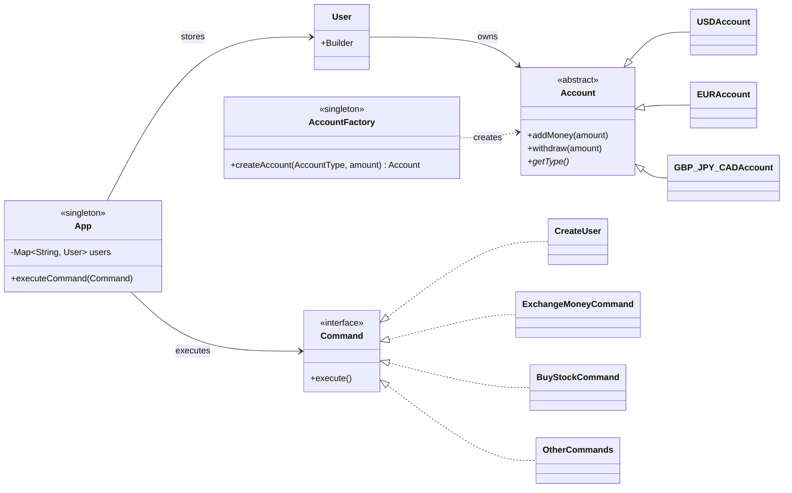

# eBanking App


A command-driven banking application in Java: users, friends, multi-currency accounts, currency exchange, transfers and a small stock portfolio with buy recommendations.
Built for the Object-Oriented Programming course at UPB (Jan–Feb 2024), with a focus on **design patterns**.

## Features

| Command | What it does |
| --- | --- |
| `CREATE USER` / `LIST USER` | Register a user and print it as JSON |
| `ADD FRIEND` | Friendship is mutual; only friends can send each other money |
| `ADD ACCOUNT` / `ADD MONEY` | One account per currency: USD, EUR, GBP, JPY, CAD |
| `EXCHANGE MONEY` | Converts using an exchange-rate table; a 1% fee applies when the amount exceeds 50% of the balance (waived for premium users) |
| `TRANSFER MONEY` | Sends money to a friend's account in the same currency |
| `BUY STOCKS` / `LIST PORTFOLIO` | Buys stocks from the USD account and prints the portfolio as JSON |
| `RECOMMEND STOCKS` | Recommends stocks whose 5-day average price is above their 10-day average |
| `BUY PREMIUM` | Costs 100 USD and removes exchange fees |

## Design



| Pattern | Where | Why |
| --- | --- | --- |
| **Command** | `Command` + one class per operation | Each input line becomes an object, so adding a new operation means adding a class, not editing a giant method |
| **Factory** | `AccountFactory` | Creates the right `Account` subclass from the currency |
| **Builder** | `User.Builder` | Readable construction of a user with optional fields |
| **Singleton** | `App`, `AccountFactory` | One shared bank state and one factory |

## Run it

Requires JDK 21.

```bash
./gradlew test        # runs the JUnit 5 suite: 8 scenarios + a bonus one
```

Each scenario lives in `src/main/resources/testN/` as a `commands.txt` file plus the expected `output.txt`; exchange rates are in `src/main/resources/common/exchangeRates.csv`.

Example input:

```text
CREATE USER john.doe@email.com John Doe 1401 Stoltenberg Islands Geralynstad SD 36945
CREATE USER marry.ville@email.com Marry Ville 7376 Lemke Common Collierstad FL 87400
ADD FRIEND john.doe@email.com marry.ville@email.com
LIST USER john.doe@email.com
```

## What I would improve today

- **Money as `BigDecimal`, not `double`**: floating-point is the wrong type for currency amounts.
- **Split `App`**: it holds state *and* all business logic; services like `ExchangeService` and `StockService` would make it testable on its own.
- **Parse commands in a factory** instead of the `switch` in `Main`, and let commands receive their dependencies instead of calling `App.getInstance()`.
- **Exceptions instead of `println`** for errors such as insufficient funds.
- **Generics everywhere** (`List<String>` instead of the raw `ArrayList` used for friends).
